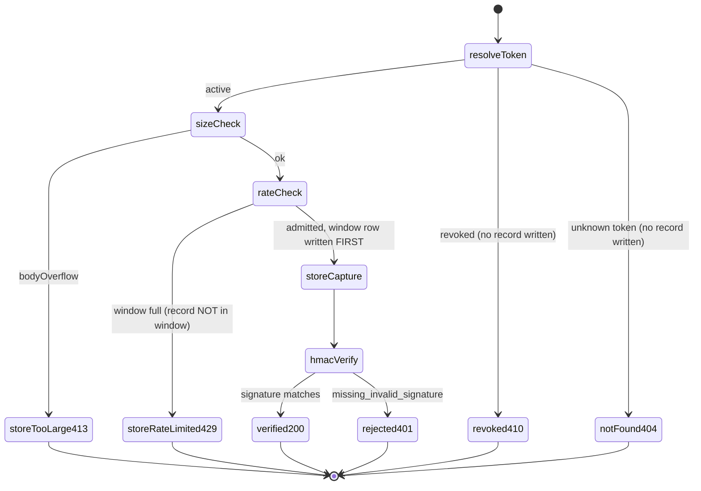
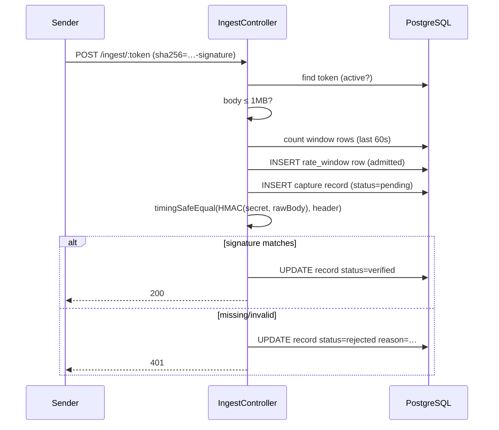
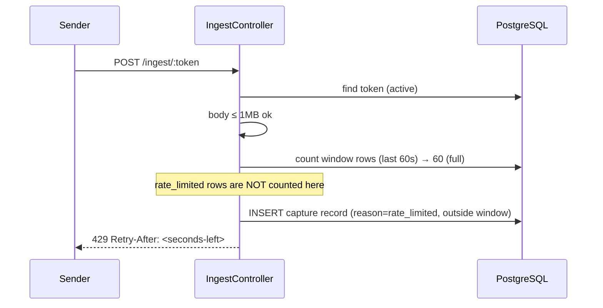
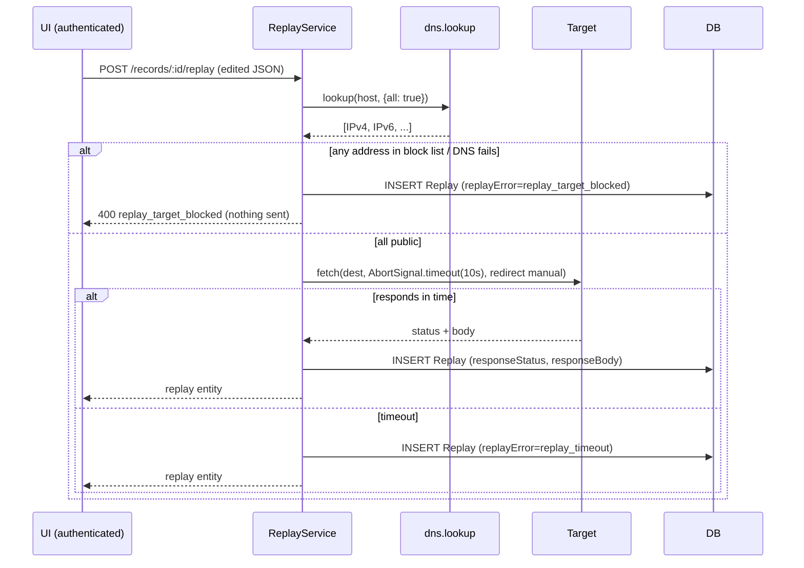

# 03 — Ingest Pipeline (critical path)

> Design only · authoritative spec: `docs/SPEC.md` · covers: raw capture → rate limit → HMAC verify → replay (SSRF) → retention → wiring/tests.
> Version facts verified against official docs: NestJS raw body FAQ (`docs.nestjs.com/faq/raw-body`), `@nestjs/schedule` task scheduling (`docs.nestjs.com/application/task-scheduling` — 6-field cron with optional seconds first, `ScheduleModule.forRoot()` exactly once).

---

## 0. Constants (single file: `src/common/constants/ingest.constants.ts`)

No magic numbers anywhere else in the ingest path:

```ts
export const RATE_LIMIT_WINDOW_MS = 60_000;        // 60s sliding window
export const RATE_LIMIT_MAX = 60;                  // per token per window
export const MAX_BODY_BYTES = 1024 * 1024;         // 1MB ingest cap
export const REPLAY_TIMEOUT_MS = 10_000;           // AbortSignal for replay fetch
export const RETENTION_DAYS = 7;
export const DEFAULT_SIGNATURE_HEADER = 'X-Hub-Signature-256';
export const SIGNATURE_PREFIX = 'sha256=';
```

---

## 1. Raw body capture

### 1.1 Why not the global JSON parser

HMAC-SHA256 must be computed over the **exact bytes received**. If `express.json()` parses first, the controller only ever sees a re-serialized object — key order, whitespace, unicode escapes differ from the sender's bytes and every signature check fails. Nest's built-in `rawBody: true` option does preserve bytes (docs: "the most common use case is webhook signature verification … the unparsed request body to calculate an HMAC hash"), but it is **global-only**: it runs the built-in parser (100kb default limit) on every route and would JSON-parse `/ingest/*` before we decide whether the payload is acceptable. Spec requires capture-first-verify-over-bytes with a stored record on oversize — so ingest gets its own path-scoped parser.

### 1.2 Chosen mechanism: path-scoped Express middleware, global bodyParser off

**Decision:** `NestFactory.create(AppModule, { bodyParser: false })` + one custom middleware registered directly on the Express app in `main.ts` **before** the global `express.json()`.

Why middleware, not interceptor/pipe/controller:

| Option | Verdict |
|---|---|
| Nest **interceptor** | Too late — runs after Express consumed the body stream; nothing left to read. |
| Nest **pipe / ValidationPipe** | Even later; operates on parsed objects, never bytes. |
| **Controller** reading `req` directly | Still needs *some* parser upstream; a controller cannot choose parser behavior per-route. |
| **Express middleware** (chosen) | The only layer that sees the raw stream before any parsing; emits the `Buffer` the HMAC needs. |

```ts
// main.ts — order matters
const app = await NestFactory.create<NestExpressApplication>(AppModule, {
  bodyParser: false,            // Nest must NOT register its global parsers first
});

// 1) ingest-scoped raw capture — registered before the JSON parser
app.use('/ingest', ingestRawBodyMiddleware());

// 2) everything else gets the normal parsers
app.use(express.json({ limit: '100kb' }));
app.use(express.urlencoded({ extended: true }));
```

`ingestRawBodyMiddleware` (`src/ingest/middleware/ingest-raw-body.middleware.ts`):

1. Streams chunks into a list, summing bytes as they arrive.
2. Total ≤ `MAX_BODY_BYTES` → `req.rawBody = Buffer.concat(chunks)` (controller types `@Req() req: RawBodyRequest<Request>`), **no JSON parsing in the middleware**, `next()`. HMAC always uses `req.rawBody`; the controller parses JSON lazily only to store a readable copy.
3. Byte counter exceeds `MAX_BODY_BYTES` → stop reading at `MAX_BODY_BYTES + 1` (one probe byte proves overflow), set `req.bodyOverflow = true`, **do not throw**, `next()`. The controller persists a record with `reason = 'body_too_large'` and answers `HttpStatus.PAYLOAD_TOO_LARGE` (413).

Why persist-then-413 instead of throwing in middleware: spec requires an audit trail for oversized payloads — a probe must still show in the timeline. Throwing early would answer 413 but write nothing. The hard stop at `MAX_BODY_BYTES + 1` guarantees a 10GB body never buffers (socket drained after the record is written).

Nest's `rawBody: true` stays **off** (global-only, would double-parse); `RawBodyRequest` is still imported from `@nestjs/common` for typing.

---

## 2. Request lifecycle — ordered state machine

`POST /ingest/:token`. Every terminal state writes its record **before** sending the response (record-then-respond, never respond-then-record) so a crashed response never leaves an invisible request.



### Ordered steps and justification

| # | Step | Outcome | Why this position |
|---|---|---|---|
| 1 | Resolve token | active / revoked / unknown | Cheapest lookup; nothing else matters if the endpoint doesn't exist. |
| 1a | revoked → `HttpStatus.GONE` (410), **no record** | | Spec: requests to a revoked token are not saved. Deliberate: a revoked endpoint is decommissioned — persisting its traffic defeats the point of revoke (the table keeps growing for a dead endpoint and leaks that the old token is still being hit). 410 tells the caller why; the DB stays clean. |
| 1b | unknown → 404, no record | | Same class: no workspace owns this traffic, nothing to attribute a record to. |
| 2 | Body size check | store `reason='body_too_large'` → 413 | Before rate limit: an oversized payload never becomes "admitted" quota. Before HMAC: signing bytes we refused to keep is meaningless. Record written **before** the 413. |
| 3 | Sliding-window rate check | full → store `reason='rate_limited'` → 429 + `Retry-After` | See §3. The rejected record is written **after** the check and is **not** counted by the window (§3.2). `Retry-After` = `ceil((oldestWindowRow.occurredAt + 60s − now) / 1000)` — seconds until the oldest admitted row expires. |
| 3a | admitted → **write window row FIRST** | | The window row is the admission ticket: written before the capture record, so if capture persistence fails the request still consumed quota (fail-closed — a failing DB can't be used to bypass the limit). |
| 4 | Save capture record | method, path+query URL, whitelist headers (`x-hub-signature`, `x-request-id`, `user-agent`, `content-type`), raw body as utf8 text, `status` pending | All reads happen before HMAC so a verify crash still leaves the full forensic record. Non-whitelisted headers (cookies, auth headers from misconfigured senders) are dropped at capture time and never stored. |
| 5 | HMAC verify | update same row → 200 `verified` / 401 `rejected` | Last: needs the record from step 4. Header name from subscriber config (default `DEFAULT_SIGNATURE_HEADER`) → must start `sha256=` → hex-decode (bad hex ⇒ `invalid_signature`) → decoded length must be 32 bytes → `crypto.timingSafeEqual` on equal-length buffers. Missing header ⇒ `missing_signature`. **Rejected is an update of the step-4 row, not a second row** — keeps the Verified/Rejected tabs one stream. |

Why rate-limit **before** HMAC: verification hashes up to 1MB per request; under flood, verifying first lets an attacker burn CPU with garbage signatures. Cheapest gate after size wins.

Why `timingSafeEqual`, not `===`: string comparison short-circuits at the first differing byte, leaking signature-prefix bytes via response timing. `timingSafeEqual` throws on unequal lengths, so check length first (digest length 32 is not secret) and return `invalid_signature` without calling it.





---

## 3. Sliding window in PostgreSQL

### 3.1 Table design

```prisma
model RateWindowRow {
  id         BigInt   @id @default(autoincrement())
  endpointId BigInt   // FK → SubscriberEndpoint, cascade delete on rotate/revoke
  occurredAt DateTime @default(now())

  @@index([endpointId, occurredAt(map: "rate_window_ep_time_idx")])
}
```

One row per **admitted** request (nothing else ever written here). Query:

```sql
SELECT count(*) FROM "RateWindowRow"
WHERE "endpointId" = $1 AND "occurredAt" > now() - interval '60 seconds';
```

- Composite index `(endpointId, occurredAt)` makes both the count (index-only scan on the filtered prefix) and the oldest-row lookup for `Retry-After` (`ORDER BY occurredAt ASC LIMIT 1`) a single index seek.
- **Clock skew:** comparisons use PostgreSQL `now()` (transaction timestamp of the DB), never app-server `Date.now()` — one clock source, zero skew between web tier and store. App-side arithmetic (Retry-After) converts to DB time or accepts ≤1s drift, which changes `Retry-After` by at most one second.
- **Window rows not needed after 60s:** retention cron also deletes `RateWindowRow` older than the window (bounded growth without a second job).
- **Rotate/reset:** rotating a token issues a new endpoint identity (or clears rows for the endpoint) — spec: "reset khi token rotate". Revocation doesn't need reset (410 path never consults the window).

### 3.2 Why `reason='rate_limited'` rows never enter the window

The window counts only requests that **passed** the check. If rejected rows were also inserted into `RateWindowRow`, every blocked request would push the window's oldest edge forward — the limit would re-lock itself on each probe, an unbounded self-extending ban where 60/min becomes "never again until traffic stops for 60s". Keeping rejects out means the window reflects **admitted** load only: the moment admitted traffic stops, the window drains in ≤60s and the endpoint recovers automatically. The rejected record still exists in `CaptureRecord` (visible in the UI), it simply isn't quota.

### 3.3 Concurrency: two requests race the check

Options considered:

| Approach | Verdict |
|---|---|
| Read-then-insert, no lock | Two racers both count 59, both insert → 61 admitted. Acceptable drift… but unbounded under parallel flood. |
| Full serializable transaction | Correct but heavy for a 1-worker demo; retry-on-conflict machinery for a 60/min limit is over-engineering. |
| **`pg_advisory_xact_lock(hashtext(endpointId))`** (chosen) | One line inside a short transaction: count + insert under a session-level advisory lock keyed by endpoint. Requests for the *same* token serialize; different tokens still run parallel. |

Chosen design:

```sql
BEGIN;
SELECT pg_advisory_xact_lock(hashtext($endpointId));   -- scope: this token only
SELECT count(*) ... WHERE occurredAt > now() - interval '60 seconds';
-- count < 60 → INSERT RateWindowRow; COMMIT  → proceed to capture
-- count ≥ 60 → ROLLBACK, no window row      → 429 path
COMMIT/ROLLBACK releases the lock automatically at transaction end.
```

Justification: at 60 req/min the serialized section is ~2 tiny queries (<5ms), throughput headroom is ~1 req/s — serialization costs nothing observable while making the limit **exact** rather than "usually 60, occasionally 61". A `SELECT … FOR UPDATE` on a per-endpoint counter row was rejected: it needs a separate counter row to lock and re-introduces the counting bug the window table avoids. Advisory lock keeps the table as the single source of truth. Drift if we had chosen "acceptable" would be fine for a demo, but the lock is *simpler to reason about* than a documented inexactness — Chesterton's Fence: the exact answer is the cheap one here.

---

## 4. Replay path with SSRF guard

Service: `ReplayService.send(replayRecordId)` (guarded app module, authenticated).

### 4.1 Resolution & block list

1. `dns.promises.lookup(hostname, { all: true })` — returns **all** A + AAAA addresses for the name (not just the first); every address must pass the check. Rejecting only the first address lets a rebinding name smuggle `127.0.0.1` in the second record.
2. Block list — deny if **any** resolved address matches (CIDR match on the packed bytes):

   | Range | Covers |
   |---|---|
   | `127.0.0.0/8` | IPv4 loopback |
   | `0.0.0.0/8` | "this network" (`0.0.0.0` itself) |
   | `10.0.0.0/8`, `172.16.0.0/12`, `192.168.0.0/16` | RFC1918 private |
   | `169.254.0.0/16` | link-local — **includes cloud metadata `169.254.169.254`** |
   | `::1` | IPv6 loopback |
   | `fc00::/7` | IPv6 unique-local |

   (Spec list; `0.0.0.0` explicitly added because it is *not* inside `127.0.0.0/8` and Node treats it as localhost-ish on connect.) DNS failure or empty answer ⇒ treat as blocked (fail closed).
3. Destination URL validation (http/https only, no credentials in URL) happens earlier at subscriber create/update; replay re-checks scheme anyway.

### 4.2 TOCTOU / DNS-rebinding stance (kept proportionate)

There is a window between `dns.lookup` and `fetch`'s own resolution where a hostile authoritative server can rebind the name to a private IP. For a **1-worker demo** (spec: no horizontal scaling, public demo of own endpoints):

- **Chosen:** resolve → validate → `fetch` immediately, no IP pinning. The window is milliseconds; the operator controls their own destinations; pinning the IP requires a custom undici dispatcher/`lookup` callback and TLS/SNI bookkeeping that outweights the threat model here.
- **Documented follow-up (not in scope):** pass `{ lookup }` into `fetch` that re-validates the address at connect time — cheap rebinding mitigation — if HookLab ever proxies for untrusted third parties.

### 4.3 Fetch, timeout, persistence

```ts
const res = await fetch(destinationUrl, {
  method: record.method,
  headers: destinationHeaders,
  body: editedBody,
  signal: AbortSignal.timeout(REPLAY_TIMEOUT_MS),   // 10s
  redirect: 'manual',                               // redirect could land on private IP — don't follow
});
```

- `redirect: 'manual'` — a 302 to `http://127.0.0.1/` would bypass the guard if followed; caller sees the 3xx as the replay's responseStatus and decides.
- **Blocked** (any address private): save replay row with `replayError = 'replay_target_blocked'`, respond `HttpStatus.BAD_REQUEST` (400) — **nothing is sent**.
- **Timeout** (AbortSignal fires): save row with `replayError = 'replay_timeout'`, respond 504-equivalent result stored in the row (the API answers 201 with the replay entity; `replayError` carries the outcome — one shape for the UI, no branching on HTTP status of the *HookLab* response).
- **Success:** save `responseStatus` (number) + `responseBody` (truncated to the same 1MB cap), `replayError = null`.
- Replay row: `replayOfId → original record (onDelete: Cascade)`, never increments received-counts (§5 bug).



---

## 5. The `replayOfId` count bug (bug-fix protocol)

**Bug:** replayed requests were saved as new records, so "requests received" and every badge grew on each replay.

**Fix shape:** replay rows live in the same `CaptureRecord` table with nullable `replayOfId` (self-reference, `onDelete: Cascade` so retention cleans replays with their original — spec's cascade requirement). Every count/badge/search flows through **one helper**:

```ts
// src/common/prisma/record-count.ts — the single chokepoint
export const receivedRecordWhere = { replayOfId: null } satisfies Prisma.CaptureRecordWhereInput;
// every count/findMany for metrics uses prisma.captureRecord.count({ where: receivedRecordWhere })
```

**Protocol:** write the regression test **first** (it must FAIL against the pre-fix code where replay inserted `replayOfId = null`), then apply the fix, then green. Test: seed 1 original + 2 replays → `count({ where: receivedRecordWhere }) === 1` (not 3); also assert timeline default listing excludes replays unless explicitly queried by id.

---

## 6. Retention cron

`@nestjs/schedule` (docs-verified: 6-field expression, seconds first; `ScheduleModule.forRoot()` in `AppModule` **once** — double import re-registers handlers and runs the job twice):

```ts
@Cron('0 0 3 * * *', { name: 'retention', timeZone: 'UTC' })
async purgeExpiredRecords() {
  const cutoff = subDays(new Date(), RETENTION_DAYS);
  const { count } = await this.prisma.captureRecord.deleteMany({
    where: { receivedAt: { lt: cutoff } },
  });
  this.logger.log(`retention: deleted ${count} records older than ${RETENTION_DAYS}d`);
}
```

- `'0 0 3 * * *'` = 03:00:00 daily; `timeZone: 'UTC'` makes the 6-field expression UTC regardless of host TZ (belt and braces — container also runs `TZ=UTC`).
- `deleteMany` on `CaptureRecord` cascades to `ReplayRecord` via the FK (`onDelete: Cascade`) and to that endpoint's old `RateWindowRow`s via their FK (window rows older than 60s are already dead weight; cascade covers stragglers).
- `@Cron` methods are wrapped in try/catch by the library and logged — failures don't crash the process; the log line (`deleted N records`) is the observable signal the story requires ("mỗi lần chạy ghi log số record đã dọn").
- **UI:** timeline footer / empty-state banner shows "Records auto-delete after 7 days" (static copy referencing `RETENTION_DAYS`, no extra endpoint).

---

## 7. NestJS wiring

```
src/
  common/
    constants/ingest.constants.ts     ← §0, the only home for magic numbers
    crypto/hmac.ts                    ← verifySignature(rawBody, headerValue, secret, headerName)
    prisma/record-count.ts            ← receivedRecordWhere (§5)
  ingest/                             ← IngestModule: PUBLIC, no JwtAuthGuard
    ingest.module.ts
    ingest.controller.ts              ← POST /ingest/:token
    ingest.service.ts                 ← lifecycle state machine §2
    rate-limit.service.ts             ← §3 advisory-lock window
    middleware/ingest-raw-body.middleware.ts   ← §1 (Express-level, registered in main.ts)
    *.spec.ts
  replay/                             ← ReplayModule: guarded (JwtAuthGuard global for app routes)
    replay.service.ts                 ← §4 SSRF + fetch
    ssrf.ts                           ← isBlockedAddress(ip) — pure, unit-tested
    replay.controller.ts
  retention/retention.service.ts      ← §6 cron
```

Module boundaries:

- **`IngestModule`** exports only the controller/service; **not** imported by guarded feature modules; registered so `/ingest/*` never passes `JwtAuthGuard` (guard applied via `APP_GUARD` but with a public-route decorator `@Public()` on ingest, or guard scope limited to app modules — pick **`@Public()` marker**: one global guard, explicit opt-out, reviewable in one place).
- **Middleware vs interceptor vs controller for raw capture:** middleware, justified in §1.2 — it is registered in `main.ts` because it must sit between Express's stream and *both* Nest's router and the global JSON parser; a `MiddlewareConsumer` in a module runs after Nest's default parser registration, which is exactly the ordering bug this design avoids (hence `bodyParser: false`).
- **Where `timingSafeEqual` lives:** `src/common/crypto/hmac.ts`, pure function `verifySignature(...) → { ok: true } | { ok: false, reason: 'missing_signature' | 'invalid_signature' }`. Controller never touches `crypto` directly — one place to audit for constant-time behavior, one place to unit-test with RFC vectors. Uses `node:crypto` `createHmac('sha256', secret)` + `timingSafeEqual`.
- **Prisma schema notes (version-neutral):** `CaptureRecord.rawBody` `String @db.Text`; `receivedAt @default(now())` indexed (retention + timeline sort); `replayOfId BigInt? @unique?` — **not unique** (one original, many replays), indexed; FK `onDelete: Cascade`; `RateWindowRow` per §3.1.

---

## 8. Unit-test cases per component

Regression-first where a known bug exists; Jest specs colocated with source (`.spec.ts`, repo convention).

**`hmac.spec.ts`** (pure)
- RFC 4231 test-case-2 vector for HMAC-SHA256 (key `"Jefe"`, data `"what do ya want for nothing?"` → known digest) through `verifySignature`.
- Valid `sha256=<hex>` over exact raw bytes → `ok`.
- Header missing → `missing_signature`.
- Header without `sha256=` prefix, odd-length hex, non-hex chars → `invalid_signature`.
- Correct hex but wrong digest (1-byte flip) → `invalid_signature`.
- **Whitespace/key-order variant:** `{"a":1,"b":2}` vs `{"b":2,"a":1}` — same parsed object, different bytes → verify against original bytes fails/passes correctly (proves capture-not-reparse).
- Length mismatch (63-char hex) does **not** throw (length checked before `timingSafeEqual`).

**`rate-limit.service.spec.ts`** (Prisma mocked by token `overrideProvider(PrismaService)`)
- 59 existing rows in window → admit (inserts window row).
- Exactly 60 rows → reject (429 path, **no** window row inserted).
- Rows older than 60s don't count (`occurredAt` boundary: `now()-60s` exact edge excluded, `now()-59.9s` included).
- Rejected `rate_limited` record write path calls `captureRecord.create` but **never** `rateWindowRow.create`.
- `Retry-After` = seconds until oldest row expires (deterministic clock injected).
- Concurrency (integration-ish, real PG in CI service container): fire 10 parallel admits against 55-in-window → exactly 5 admitted, 5 rejected (advisory lock held).

**`ingest-raw-body.middleware.spec.ts`** (mock req/res stream)
- Body exactly `MAX_BODY_BYTES` → `rawBody` set, no overflow.
- Body `MAX_BODY_BYTES + 1` → `bodyOverflow = true`, buffering stopped at cap+1 (assert buffered length ≤ cap+1 even when the stream offers 10MB).
- Non-JSON body passes through unparsed (raw bytes intact).

**`ingest.service.spec.ts`**
- Unknown token → 404, `captureRecord.create` never called.
- Revoked token → 410, `create` never called (**Chesterton note:** this is intentional per §2, test documents the fence).
- Oversized → record with `body_too_large` created **before** 413 (assert call order via mock invocationCallOrder).
- Verified / missing / invalid signature → 200 / 401 / 401 with correct `reason`, exactly one record row per request.

**`ssrf.spec.ts`** (pure, table-driven)
- Each blocked range boundary: `127.0.0.1`, `127.255.255.255`, `10.0.0.1`, `172.16.0.1`, `172.31.255.255`, `192.168.1.1`, `169.254.169.254` (metadata), `0.0.0.0`, `::1`, `fc00::1`, `fd12:3456::1`.
- Allowed: `8.8.8.8`, `93.184.216.34`, `2606:4700::1111`.
- `lookup` returning **mixed** list `['93.184.216.34','127.0.0.1']` → blocked (all-addrs rule).
- DNS failure → blocked (fail closed).

**`replay.service.spec.ts`**
- Blocked target → `replayTarget_blocked` row created, `fetch` **not** called (mock throws if called), 400.
- AbortSignal timeout → row with `replay_timeout`.
- Success → row with `responseStatus` + `responseBody`.

**`record-count.spec.ts` — regression first (bug-fix protocol)**
1. **Write FAILING test before the fix:** seed 1 original + 2 replays, assert `count({ where: receivedRecordWhere }) === 1`. Under pre-fix code (replays stored with `replayOfId: null`) this fails at 3.
2. Apply fix (replay inserts `replayOfId: original.id`; all metric queries route through `receivedRecordWhere`).
3. Green + one extra assertion: every metric/badge query site uses the helper (grep-level review, documented in PR body).

---

## 9. Deliberately left undecided

- **Exact ingest route mounting** (`/ingest/:token` controller path vs `All` verb): `POST` per spec; non-POST methods are not part of the story — behavior for GET to an ingest URL (405 vs capture) not specified.
- **Replay request body encoding:** whether edited payload is sent as the original `content-type` or forced `application/json` — decided only that spec says JSON/text, no binary.
- **Whether `body_too_large` stores the first 1MB of body or a truncation marker** — record must exist either way; storing 1MB of an attacker's body vs a marker is a storage-cost tradeoff for implementation.
- **`Retry-After` rounding** (ceil vs floor) — either passes the load-test story; ceil chosen in §2 but not load-bearing.
- **RateWindowRow cleanup ownership** (retention cron cascade vs explicit deleteMany in the same cron) — both satisfy the spec; implementation picks cascade-only if FK from window → endpoint already cascades.
- **IPv4-mapped IPv6 (`::ffff:127.0.0.1`) normalization** — should be unwrapped before CIDR match; listed here because the block-list table in §4.1 assumes it, and the pure `isBlockedAddress` test list above doesn't yet include it — add alongside implementation.
